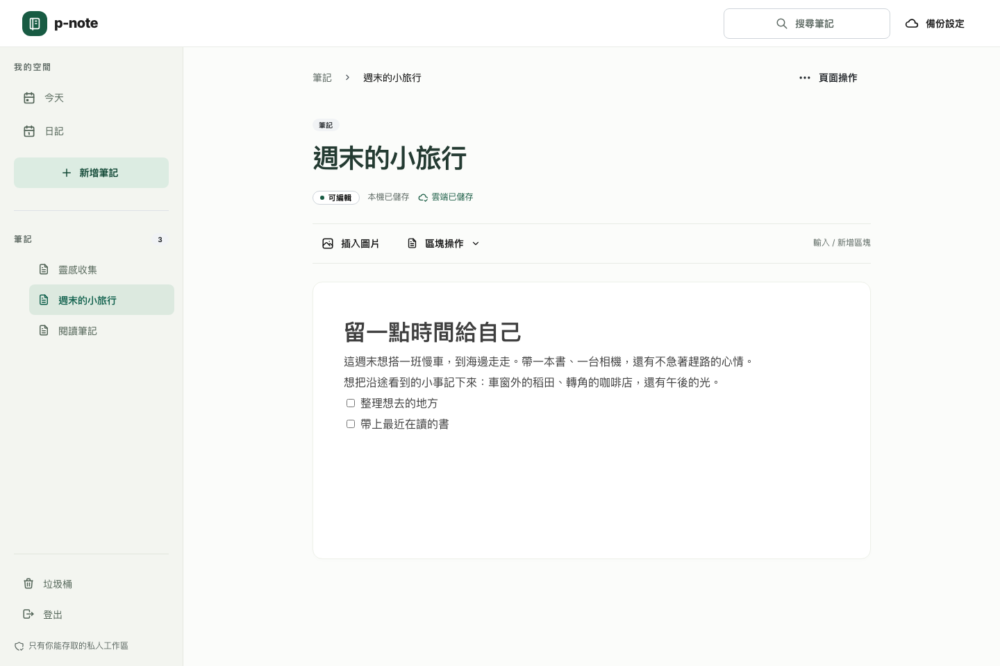
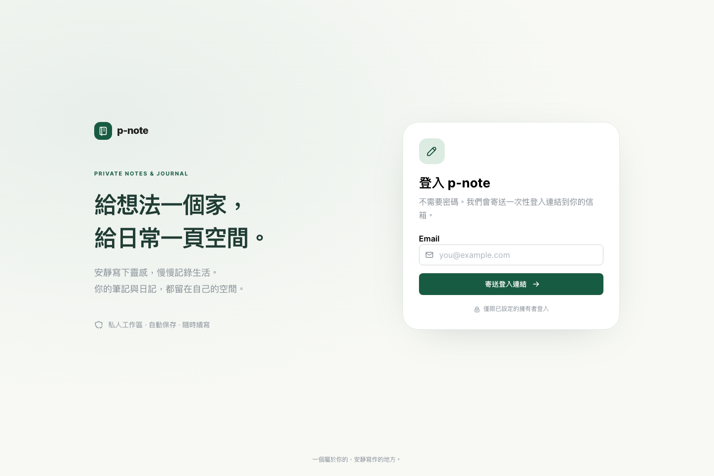

# Mantine 工作區重設

使用者要求全面重做不可理解且缺乏視覺設計的介面。此次使用 Mantine 9.7.2、Tabler 圖示與共用 Provider；BlockNote 支援同版本，正文資料格式與同步後端沿用原實作。

## 改版內容

- 登入：雙欄說明與登入卡片，手機收斂為單欄；清楚解釋一次性郵件連結、成功提示、失敗與重新申請。
- 工作區：固定側欄、目前筆記標記、頁面路徑、大標題、閱讀寬度與獨立正文區。灰綠側欄、深綠主色、霧白背景，字級與間距使用一致尺度。
- 手機：44px 主操作、Drawer 導覽、375px 不水平溢出。正文保持首屏可見；圖片和管理表單不常駐占用空間。
- 管理：搜尋、日記日期／月份、頁面操作、垃圾桶與圖片各有具名 Modal；Escape 關閉與焦點返回。移到垃圾桶先確認目標，仍可還原。
- 編輯：使用繁體中文 BlockNote 文案；插入圖片與區塊工具列，動作完成回到正文。區塊操作使用可捲動對話框，避免 Safari 縮小視窗後選單消失；FileInput 顯示繁體中文提示與所選檔名。保留失敗重試、本機與雲端保存確認。圖片重試仍使用原檔。
- 備份：空狀態、載入／錯誤、帶日期與狀態的卡片、ZIP 下載與覆蓋確認；保留中斷重試識別。
- 草稿：登入到期仍能檢視唯讀草稿並重新登入，雲端還原後的舊草稿可檢視／另存，不因切換介面遺失。

## 自動化驗收與畫面

[UI-01～06 測試](../tests/e2e/workspace-ui.spec.ts)檢查用途說明、主操作、首屏正文、無溢出、手機抽屜、具名對話框、搜尋空狀態、焦點返回、日期與頁面設定、取消刪除、圖片面板、備份列表與覆蓋確認。舊版六個桌面情境以正確原因失敗，見 [Red](tdd/red-workspace-ui.log)。

初期 [桌面流程](tdd/ui-workflows-desktop.log) 與 [調整後流程](tdd/ui-workflows-fixed.log) 保留入口切換與動畫等失敗紀錄；不以增加 timeout 或重試設定掩蓋。最終結果以 [完整瀏覽器回歸](tdd/ui-final-e2e.log)、[單元](tdd/ui-unit.log)、[Workers](tdd/ui-integration.log)、[真實建置](tdd/ui-build-smoke.log)、[型別](tdd/ui-types.log)、[文件契約](tdd/ui-contract.log)、[OpenSpec](tdd/ui-openspec.log)及情境追蹤為準。

[首次全套回歸](tdd/ui-first-full-e2e.log) 的 7 個失敗保留原始證據。修正包含使用語意 combobox 查詢本機版本、避免點擊手機隱藏文字、區塊工具改用 Modal 與可存取展開狀態，以及等候面板動畫完成才截圖；[針對性確認](tdd/ui-targeted-confirmation.log) 的 30 個情境全部通過。圖片選擇器另有 [Red](tdd/red-mantine-image-input.log) 與 [6 個瀏覽器 Green](tdd/ui-image-final.log)。情境報告解析器也有 [UI 識別 Red](tdd/red-ui-coverage.log)，避免只計算舊功能而漏掉介面驗收。

[第二次全套回歸](tdd/ui-second-full-e2e.log) 有 167 個通過與一個 Safari 連續複製逾時：測試再次點擊正在退場的按鈕。操作 helper 改為等待對話框確實關閉，[12 個剪貼簿成功／拒絕驗證](tdd/ui-clipboard-final.log)全部通過，再執行完整回歸。以上失敗紀錄不刪除、不混算為最終成功結果。

[第三次全套回歸](tdd/ui-third-full-e2e.log) 有 167 個通過與一個 Safari 重新命名後的連續頁面操作失敗。所有面板入口加入 `aria-haspopup`／`aria-expanded`，helper 使用真正的展開狀態，避免將退場中的 DOM 當成已開啟。修正後 [21 個面板狀態驗證](tdd/ui-modal-state-final.log)全部通過，最終固定程式碼再次完整回歸。

## 目前驗收與發布狀態

2026-10-14 更新：任務 8／8 完成。完整本機驗收在後續可用性修正的程式碼（`e82c35b`）上完成：[完整瀏覽器回歸](tdd/ux-final-e2e.log) 213 個通過、[UI 情境覆蓋](tdd/ux-ui-coverage.log) 18／18，其餘檢查見 [可用性修正驗收](ux-polish.md)。以下保留當時的歷史狀態。

2026-10-14：任務 7／8 完成，Mantine 改版已部署至 [note.tonypepe.com](https://note.tonypepe.com)，完整本機驗收仍待完成。6 個單元、92 個 Workers 測試及 2 個真實 HTTPS 建置情境通過；[第四次全套回歸](tdd/ui-fourth-full-e2e.log)為 158／168 通過。後段系統負載升到 140～174，Safari 出現 10 個未通過情境；[匿名系統統計](tdd/ui-environment.log)保存負載與記憶體資料，不記錄其他程序或使用者內容。

E2E 改以正式 `dist` 與 Vite preview 執行，沿用相同 API／WebSocket 測試後端、三種瀏覽器、20 秒整體逾時、5 秒斷言及零重試，驗收直接覆蓋將上線的產物。[正式建置流程試跑](tdd/ui-built-workflows.log)的 JSON 報告為 16 個通過、4 個失敗、7 個未完成，並有中止錯誤；因持續高負載而中止，不將這次中止視為成功。[狀態摘要](tdd/ui-current-status.json)列出實際結果。

依使用者本次明確部署指示，發布 UI 程式提交 `af44c33`，Cloudflare 版本為 `56d44ed5-bf03-4942-afe9-55b2a1929392`，見 [發布紀錄](tdd/ui-production-deploy.log)。建置、型別、文件契約及發布預檢通過；`npm run test:production -- --ui` 已驗證正式 HTTPS、私人 API／測試入口、新版 Mantine 登入畫面無溢出、實際郵件送達、一次性登入、雙向 wss 保存及全新 context 載入。專用驗證筆記已正常移入垃圾桶。

證據為 [正式結果](tdd/ui-production-results.json)、[執行紀錄](tdd/ui-production-smoke.log)、[郵件來源與 SPF／DKIM／DMARC](tdd/ui-production-mail.json)及 [正式登入截圖](screenshots/ui/production-login.png)。保留上一版發布證據，不保存郵件本文、登入 token 或 session cookie。待環境穩定後，仍需重新完成全套、產品與 UI 情境覆蓋；正式驗證通過不代表本機全套驗收完成。

以下是真實瀏覽器截圖；範例筆記只寫在本機隔離測試資料庫，不是假 UI 圖，也不是使用者正式內容。每輪測試從相同儲存、登入與操作開始。開發過程檢視桌面與手機、登入／主頁／面板／備份的實際畫面，不以「測試通過」代替視覺檢查。

其他畫面：

- [手機 375px 工作區](screenshots/ui/after-chromium-mobile-workspace.png)
- [手機抽屜](screenshots/ui/after-chromium-mobile-navigation.png)
- [日記回顧](screenshots/ui/after-chromium-desktop-journal.png)
- [搜尋](screenshots/ui/after-chromium-desktop-search.png)
- [圖片上傳](screenshots/ui/after-chromium-desktop-image-upload.png)
- [備份與覆蓋確認](screenshots/ui/after-chromium-desktop-backup-restore.png)
- [舊桌面工作區](screenshots/ui/before-chromium-desktop-workspace.png)

## 驗證界線

視覺偏好無法由測試證明每個人都喜歡；幾何與工作流程已有可重跑的機器斷言，並交付實際截圖。手機與中文輸入仍使用瀏覽器裝置／事件模擬，沒有宣稱實體手機鍵盤或長期雲端運作已被驗證。此次不遷移／重設正式資料。
